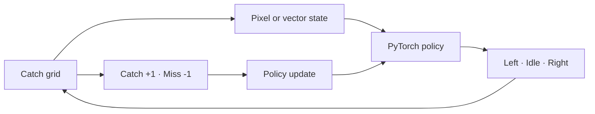

<p align="center">
  
</p>

<p align="center">
  <a href="https://www.python.org/"></a>
  
  
</p>

**Catch RL** is a compact reinforcement-learning sandbox where policy-gradient agents learn to position a paddle beneath falling balls. It combines a configurable grid environment with PyTorch implementations of REINFORCE and actor–critic, letting you compare observation formats, exploration settings, bootstrapping, and environment dynamics.

## Highlights

- A custom Catch environment with left, idle, and right actions.
- Configurable board dimensions, drop speed, episode length, and miss limit.
- Two policy-gradient implementations: REINFORCE and actor–critic.
- Pixel-board and compact vector observation modes.
- Preset experiment configurations, optional rendering, and optional Weights & Biases logging.

## How it works



A ball enters at the top of the grid while the agent controls a bottom-row paddle. Catching a ball returns `+1`; missing one returns `-1`. An episode ends at the configured step limit or after the configured number of misses.

## Tech stack

| Area | Tools |
| --- | --- |
| Learning agents | Python, PyTorch |
| Environment | NumPy, Gym spaces |
| Rendering | Matplotlib |
| Experiment tracking | Weights & Biases |
| Experiment runner | `argparse`, configuration presets |

## Quick start

```bash
python -m venv venv
```

```powershell
# Windows PowerShell
.\venv\Scripts\Activate.ps1
pip install -r requirements.txt
```

Train either included baseline with its default arguments:

```bash
python Reinforce.py
python ActorCritic.py
```

Run the configured experiment suite, or select a named configuration:

```bash
python experiments.py
python experiments.py --experiment Baseline
```

Inspect each training script’s supported options with `python Reinforce.py --help` and `python ActorCritic.py --help`. Weights & Biases is only used when the corresponding `--wandb` argument is enabled.

## Project structure

```text
catch-rl/
├── catch.py                 # Configurable Catch environment and renderer
├── Reinforce.py             # REINFORCE model and training entry point
├── ActorCritic.py           # Actor–critic model and training entry point
├── experiments.py           # Preset experiment runner
├── experiments_config.py    # Experiment groups and hyperparameters
├── figures/                 # Saved experiment visualizations
├── requirements.txt         # Python dependencies
└── assets/banner.svg        # Project banner
```

## Results & learnings

The included figures compare runs across learning rates, entropy regularization, bootstrap and baseline choices, observation types, board sizes, and ball speeds. The repository does not include a consolidated results table, so no aggregate performance claims are made here.

---
